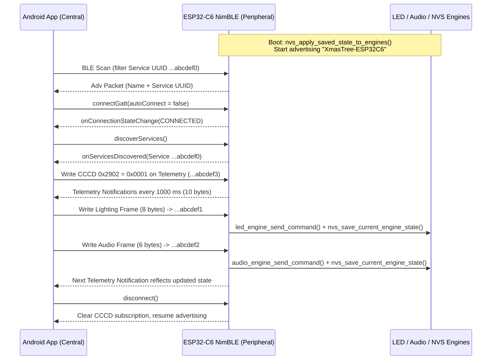

# Bluetooth Low Energy (BLE) Interface Specification

**System:** Smart Neopixel Xmas Tree Remote Control System  
**Roles:** Android Client (BLE Central / GATT Client) ↔ ESP32-C6 Firmware (BLE Peripheral / GATT Server)  
**Target Firmware Stack:** ESP-IDF NimBLE  
**Target Client Stack:** Native `android.bluetooth` API with Kotlin Coroutines / `callbackFlow`

---

## 1. GAP & Advertising Profile

| Parameter | Value / Specification | Notes |
| :--- | :--- | :--- |
| **Advertised Device Name** | `XmasTree-ESP32C6` | Defined in `BLE_DEVICE_NAME` ([`gatt_profile.h`](../src/firmware/include/gatt_profile.h)) and `GattProfile.DEVICE_NAME` ([`GattProfile.kt`](../src/android/app/src/main/java/com/xmastree/remote/protocol/GattProfile.kt)). |
| **Primary Service UUID in Adv** | `12345678-1234-5678-1234-56789abcdef0` | Included in advertising / scan-response packet for Android `ScanFilter` matching. |
| **ATT MTU** | `23` bytes default (20-byte ATT payload) | All frames are ≤ 10 bytes, fitting in a single ATT Write / Notify packet without fragmentation. |
| **Role** | ESP32-C6 = Peripheral / GATT Server Android = Central / GATT Client | Single active central connection expected; disconnecting returns ESP32-C6 to `BLE_STATE_ADVERTISING`. |

---

## 2. GATT Service & Characteristics

### 2.1 Custom Service

- **Service UUID (128-bit):** `12345678-1234-5678-1234-56789abcdef0`
- **NimBLE Little-Endian Byte Order:** `{ 0xf0, 0xde, 0xbc, 0x9a, 0x78, 0x56, 0x34, 0x12, 0x78, 0x56, 0x34, 0x12, 0x78, 0x56, 0x34, 0x12 }`

### 2.2 Characteristics Table

| Characteristic | 128-bit UUID | Properties | Payload Size | Direction | Purpose |
| :--- | :--- | :--- | :---: | :--- | :--- |
| **Lighting Control** | `12345678-1234-5678-1234-56789abcdef1` | `WRITE`, `WRITE_NO_RESPONSE` | 8 bytes | Android → ESP32-C6 | Set LED pattern, RGB color, brightness, and animation speed. |
| **Audio Control** | `12345678-1234-5678-1234-56789abcdef2` | `WRITE`, `WRITE_NO_RESPONSE` | 6 bytes | Android → ESP32-C6 | Play/pause/stop festive RTTTL melodies, set volume and tempo. |
| **System Status / Telemetry** | `12345678-1234-5678-1234-56789abcdef3` | `READ`, `NOTIFY` | 10 bytes | ESP32-C6 → Android | Periodic (1000 ms) and on-demand device state & error reporting. |

### 2.3 Client Characteristic Configuration Descriptor (CCCD)

- **Telemetry CCCD UUID:** `00002902-0000-1000-8000-00805f9b34fb` (standard BLE `0x2902`)
- **Enable Notifications:** Android writes `0x01, 0x00` (`BluetoothGattDescriptor.ENABLE_NOTIFICATION_VALUE`) after `setCharacteristicNotification(telemetryChar, true)`.
- **Disable Notifications:** Android writes `0x00, 0x00` (`BluetoothGattDescriptor.DISABLE_NOTIFICATION_VALUE`).
- **Firmware Behavior:** [`ble_manager_set_telemetry_subscribed`](../src/firmware/src/ble_manager.c) gates [`ble_manager_telemetry_tick`](../src/firmware/src/ble_manager.c) so notifications are only emitted while `BLE_STATE_CONNECTED` and subscribed. Disconnecting automatically clears the subscription flag.

---

## 3. Binary Wire Protocol Specifications

All multi-byte integer fields use **Little Endian** byte order. Payloads have **1-byte struct packing** (`#pragma pack(push, 1)`).

### 3.1 Lighting Control Frame (`8 Bytes`)

Written to `CHARACTERISTIC_LIGHTING_UUID` (`...abcdef1`).

| Offset | Field | Type | Valid Values / Range | Description |
| :---: | :--- | :---: | :--- | :--- |
| `0` | `command_id` | `uint8` | `0x01`, `0x02`, `0x03` | `0x01`: Set Pattern `0x02`: Set Static Color `0x03`: Set Brightness |
| `1` | `pattern_id` | `uint8` | `0` – `5` | `0`: Off `1`: Static Color `2`: Rainbow Wave `3`: Sparkle `4`: Festive Candle `5`: Twinkle |
| `2` | `red` | `uint8` | `0` – `255` | Primary Red intensity |
| `3` | `green` | `uint8` | `0` – `255` | Primary Green intensity |
| `4` | `blue` | `uint8` | `0` – `255` | Primary Blue intensity |
| `5` | `brightness` | `uint8` | `0` – `100` | Global brightness percentage (`0%` – `100%`) |
| `6` | `speed` | `uint8` | `1` – `100` | Animation speed (`1` = slowest, `100` = fastest) |
| `7` | `reserved` | `uint8` | `0x00` | Reserved alignment byte |

#### Validation Rules (Firmware & Client)
- Exact frame length must be `8` bytes (`LIGHTING_PAYLOAD_SIZE`).
- `command_id` must be in `{0x01, 0x02, 0x03}`.
- `pattern_id` must be in `{0..5}`.
- `brightness <= 100` and `1 <= speed <= 100`.
- On valid write, firmware updates `led_engine`, persists state to NVS (`"xmas_tree"` namespace), and returns `PROTOCOL_OK`.

#### Wire Examples
- **Rainbow Wave at 80% brightness, speed 50:**  
  `01 02 00 00 00 50 32 00`
- **Static Warm Red (`#FF3200`) at 100% brightness, speed 1:**  
  `02 01 FF 32 00 64 01 00`
- **Turn LEDs Off:**  
  `01 00 00 00 00 00 32 00`

---

### 3.2 Audio Control Frame (`6 Bytes`)

Written to `CHARACTERISTIC_AUDIO_UUID` (`...abcdef2`).

| Offset | Field | Type | Valid Values / Range | Description |
| :---: | :--- | :---: | :--- | :--- |
| `0` | `command_id` | `uint8` | `0x10` – `0x13` | `0x10`: Play Song `0x11`: Stop Audio `0x12`: Play Frequency Tone `0x13`: Set Volume |
| `1` | `melody_id` | `uint8` | `0` – `4` | `0`: Silent `1`: Jingle Bells `2`: We Wish You a Merry Christmas `3`: Silent Night `4`: Deck the Halls |
| `2` | `playback_state` | `uint8` | `0x00` – `0x02` | `0x00`: Stop `0x01`: Play `0x02`: Pause |
| `3` | `volume` | `uint8` | `0` – `100` | Speaker PWM volume (`0%` – `100%`) |
| `4` | `tempo` | `uint8` | `50` – `200` | Tempo multiplier in percent (`100` = 1.0× normal speed) |
| `5` | `reserved` | `uint8` | `0x00` | Reserved alignment byte |

#### Validation Rules (Firmware & Client)
- Exact frame length must be `6` bytes (`AUDIO_PAYLOAD_SIZE`).
- `command_id` must be in `{0x10, 0x11, 0x12, 0x13}`.
- `melody_id` must be in `{0..4}`.
- `playback_state` must be in `{0x00, 0x01, 0x02}`.
- `volume <= 100` and `50 <= tempo <= 200`.
- On valid write, firmware updates `audio_engine` (LEDC PWM on `GPIO 19`) and persists active volume/melody/tempo to NVS.

#### Wire Examples
- **Play Jingle Bells at 75% volume, 100% tempo:**  
  `10 01 01 4B 64 00`
- **Pause playback:**  
  `10 01 02 4B 64 00`
- **Stop audio:**  
  `11 00 00 00 64 00`

---

### 3.3 System Status / Telemetry Frame (`10 Bytes`)

Read from or notified via `CHARACTERISTIC_TELEMETRY_UUID` (`...abcdef3`).

| Offset | Field | Type | Valid Values / Range | Description |
| :---: | :--- | :---: | :--- | :--- |
| `0..3` | `system_uptime` | `uint32` (LE) | `0` – `2^32 - 1` | Firmware uptime in seconds (Little Endian) |
| `4` | `current_pattern` | `uint8` | `0` – `5` | Active LED Pattern ID |
| `5` | `current_melody` | `uint8` | `0` – `4` | Active Melody ID |
| `6` | `current_brightness` | `uint8` | `0` – `100` | Active LED brightness (`%`) |
| `7` | `current_volume` | `uint8` | `0` – `100` | Active audio volume (`%`) |
| `8` | `connection_state` | `uint8` | `0`, `1` | `0`: Disconnected, `1`: Connected |
| `9` | `error_code` | `uint8` | `0x00` – `0x02` | `0x00`: OK `0x01`: NVS Error `0x02`: LED Timing Error |

#### Wire Example
- **Uptime = 258 s (`0x00000102`), Twinkle (`5`), Silent Night (`3`), Brightness `85` (`0x55`), Volume `70` (`0x46`), Connected (`1`), OK (`0`):**  
  `02 01 00 00 05 03 55 46 01 00`

---

## 4. Connection & Synchronization Lifecycle

---

## 5. Android Client Implementation Requirements

1. **Runtime Permissions:**
   - **Android 12+ (API 31+):** `BLUETOOTH_SCAN` (with `neverForLocation` flag if not using location) and `BLUETOOTH_CONNECT`.
   - **Android ≤ 11 (API ≤ 30):** `BLUETOOTH`, `BLUETOOTH_ADMIN`, and `ACCESS_FINE_LOCATION`.
2. **Thread-Safe Command Queueing:**
   - Android `BluetoothGatt` allows only **one** outstanding GATT operation at a time. All `writeCharacteristic` / `writeDescriptor` / `readCharacteristic` calls must be serialized (e.g., via a Kotlin `Channel` or `Mutex`) and await `onCharacteristicWrite` / `onDescriptorWrite`.
3. **GATT Error 133 Handling:**
   - Call `gatt.close()` on disconnect/failure before retrying `connectGatt()` with exponential backoff (e.g., 1–2 retries).
4. **Protocol & Code Mapping:**
   - Android UUIDs: [`GattProfile.kt`](../src/android/app/src/main/java/com/xmastree/remote/protocol/GattProfile.kt) / [`GattProfile.java`](../src/android/app/src/main/java/com/xmastree/remote/protocol/GattProfile.java)
   - Android Codecs: [`ProtocolSpec.kt`](../src/android/app/src/main/java/com/xmastree/remote/protocol/ProtocolSpec.kt) / [`ProtocolSpec.java`](../src/android/app/src/main/java/com/xmastree/remote/protocol/ProtocolSpec.java)
   - Firmware UUIDs: [`gatt_profile.h`](../src/firmware/include/gatt_profile.h)
   - Firmware Codecs: [`protocol_spec.h`](../src/firmware/include/protocol_spec.h) / [`protocol_spec.c`](../src/firmware/src/protocol_spec.c)
